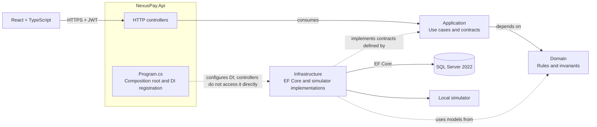
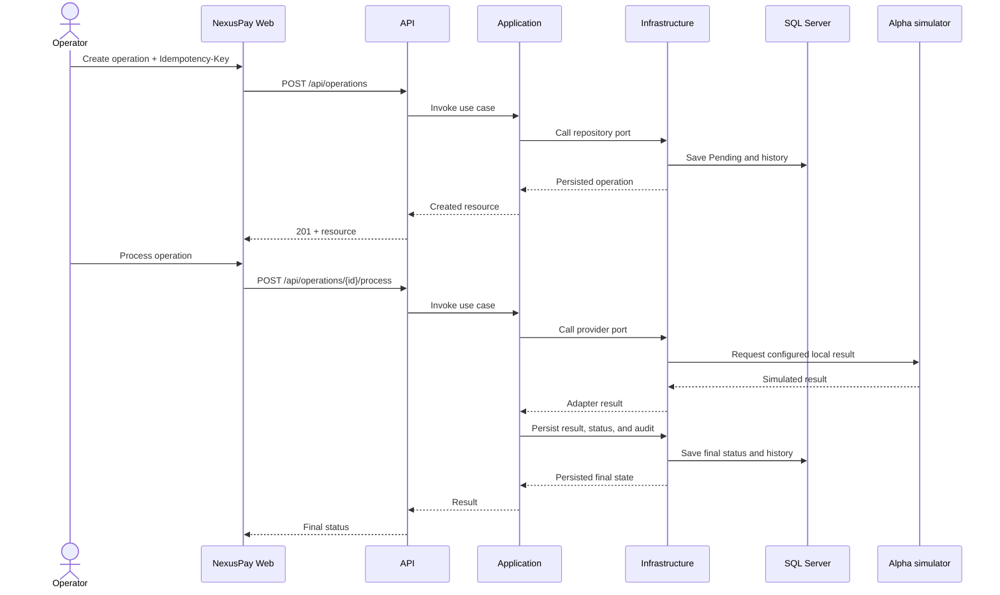

# NexusPay

## Financial Operations & API Integration Platform

NexusPay is a portfolio-grade demo application for managing fictional customers, simulated financial operations, local payment-provider simulators, audit records, and reports. **It does not move real money, use payment cards, or connect to banks.**

## Project status

The backend implements JWT authentication and role authorization, customer/user/provider management, simulated payment processing, a persisted-data dashboard, audit and integration logs, and paginated/CSV reports. The frontend provides login, role-aware navigation, and connected pages for these modules. Development runs against a dedicated SQL Server 2022 Docker container; the separate `MSSQLSERVER04` SQL Server 2016 instance remains untouched.

Local verification recorded on 2026-11-06:

- Backend: 21 unit tests and 7 SQL Server integration tests passed.
- Frontend: lint and build passed in the current UX update; the 3 Vitest tests passed in the earlier verification and were not rerun for this update.
- EF Core: four migrations applied, no pending model changes.
- CI workflow is defined to start an ephemeral SQL Server 2022 instance and upload TRX results. It has not been run on GitHub from this session.

## Features

- JWT sign-in, password change, and `Administrator`, `Operator`, and `Auditor` roles.
- Customer create/read/update, search, filters, pagination, and soft deactivation.
- Idempotent operation creation, status history, cancellation, and simulated processing with configurable approval, rejection, technical-error, and timeout results.
- User and role administration with transactional, audited changes.
- Read and manage simulated-provider metadata.
- Persisted dashboard metrics, audit and integration logs, and operation/customer/provider reports in JSON and CSV. CSV exports are limited to 10,000 rows.
- Responsive web pages for the available modules.

The processor currently uses the simulator selected by `PaymentSimulation` configuration. Registering another provider stores its metadata and status; it does not install a new executable adapter. There are no bank integrations or external calls.

## Technology stack

- **Backend:** C#, .NET 10, ASP.NET Core Web API, EF Core 10, FluentValidation, ASP.NET Core Identity, JWT, Serilog, Swagger.
- **Frontend:** React, TypeScript, Vite, Tailwind CSS, React Router, React Hook Form, Zod, Recharts.
- **Testing:** xUnit, `Microsoft.AspNetCore.Mvc.Testing`, Vitest, React Testing Library, jsdom.
- **Database/CI:** SQL Server 2022 Developer, Docker Desktop, GitHub Actions.

## Architecture and operation flow

The solution applies pragmatic Clean Architecture without MediatR or AutoMapper:



Code dependencies point inward to Domain. The API-to-Infrastructure reference is used by `Program.cs` to register implementations in Dependency Injection; controllers consume Application use cases. Infrastructure implements contracts defined by Application.



Production projects live under `src/NexusPay.Api`, `Application`, `Domain`, and `Infrastructure`; tests are under `tests/`; the frontend is `frontend/nexuspay-web`; technical documentation and ADRs are under `docs/`. See [architecture](docs/architecture/architecture.md), [database design](docs/database/database-design.md), [ERD](docs/database/erd.md), and [API guide](docs/api/api-guide.md).

## Requirements

- .NET SDK 10.0.300 or later in the 10.0 feature band.
- Node.js 24 and npm.
- Docker Desktop with Linux/WSL 2 engine, or a compatible SQL Server 2022 instance.
- Git. Visual Studio or VS Code are optional.

On this computer, the `mcr.microsoft.com/mssql/server:2022-latest` image occupies about **2.35 GB** in Docker. Its first pull also uses network bandwidth and disk space. SQL Server consumes memory and CPU while running. There is no cloud-service charge; SQL Server Developer terms apply to development and testing.

## Local setup

### 1. Start SQL Server

This workspace already has a dedicated container and volume:

```powershell
docker start nexuspay-sql2022
```

On another machine, use a new SQL Server 2022 container and a new volume on an available port. Do not reuse or remove volumes that contain data. In this setup SQL is bound to `127.0.0.1:1433` and is independent of SQL Server 2016.

The `NexusPay` database and development login `nexuspay_app` are already provisioned in this workspace. On a new installation, provision a database and a development application login with schema permissions through SQL Server Management Studio or your DBA process.

### 2. Configure local secrets

The API reads private values from .NET User Secrets. Never put connection credentials or signing keys in `appsettings.json`, committed files, `VITE_*` variables, or screenshots.

```powershell
dotnet user-secrets set "ConnectionStrings:NexusPay" "Server=localhost,1433;Database=NexusPay;User Id=nexuspay_app;Password=<local-password>;Encrypt=False;TrustServerCertificate=True" --project src/NexusPay.Api
dotnet user-secrets set "BootstrapAdmin:Email" "admin@nexuspay.local" --project src/NexusPay.Api
dotnet user-secrets set "BootstrapAdmin:Password" "<strong-local-password>" --project src/NexusPay.Api
```

Generate a random Base64 JWT key with at least 32 bytes and store it as `Jwt:SigningKey` in User Secrets. This PowerShell example does not print the key:

```powershell
$bytes = New-Object byte[] 48
[Security.Cryptography.RandomNumberGenerator]::Fill($bytes)
$jwtKey = [Convert]::ToBase64String($bytes)
dotnet user-secrets set "Jwt:SigningKey" $jwtKey --project src/NexusPay.Api
Remove-Variable jwtKey, bytes
```

In Development, startup creates the roles and the configured bootstrap administrator if missing. The frontend only needs the public API URL; copy `.env.example` to `.env.local` if you need to change it.

### 3. Restore, migrate, and run

```powershell
dotnet restore NexusPay.sln
dotnet ef database update --project src/NexusPay.Infrastructure --startup-project src/NexusPay.Api
dotnet run --project src/NexusPay.Api --launch-profile http
```

API: `http://localhost:5062`; Swagger (Development only): `http://localhost:5062/swagger`; API/database health: `http://localhost:5062/health`.

In another terminal:

```powershell
cd frontend/nexuspay-web
npm ci
npm run dev
```

Frontend: `http://localhost:5173`. Sign in with the account configured in User Secrets.

## Database and case-insensitive behavior

The database uses `Latin1_General_100_CI_AS` (case-insensitive, accent-sensitive). Emails and codes are normalized and protected by unique indexes. Operational tables are `Customers`, `FinancialOperations`, `OperationStatusHistory`, `PaymentProviders`, `PaymentAttempts`, `IntegrationLogs`, and `AuditLogs`; Identity adds its seven standard tables. Amounts use `decimal(18,2)`, operations have `rowversion`, and foreign keys restrict deletion. See the [database design](docs/database/database-design.md) and [ERD](docs/database/erd.md).

## API and roles

All routes require a Bearer JWT except login and health. `Administrator` manages users and providers; `Administrator`/`Operator` can write customers and operations; `Auditor` can read operations, logs, audit data, and reports. Backend authorization is enforced regardless of UI visibility.

Main routes: `POST /api/auth/login`, `GET /api/auth/me`, `POST /api/auth/change-password`; `/api/users`; `/api/customers`; `/api/operations`; `GET/POST /api/providers`, `PUT /api/providers/{id}`; `/api/audit-logs`; `/api/integration-logs`; `/api/dashboard/summary`; `/api/reports/operations`, `/customers`, and `/providers`, each with a `.csv` download; `GET /health`. See the [API guide](docs/api/api-guide.md) for roles, filters, payloads, pagination, and errors.

Example operation request (requires an active customer):

```http
POST /api/operations
Authorization: Bearer <token>
Idempotency-Key: <unique-request-key>
Content-Type: application/json

{"customerId":"<guid>","type":"Payment","amount":25.50,"currency":"PEN","description":"Fictional payment"}
```

Repeating the same key and payload returns the existing resource; reusing the key with a different payload results in a conflict.

## Testing

Backend (integration tests require SQL Server 2022 and an isolated database):

```powershell
dotnet test NexusPay.sln -c Release
```

Configure `ConnectionStrings:NexusPayIntegrationTests`, `NEXUSPAY_TEST_ADMIN_EMAIL`, and `NEXUSPAY_TEST_ADMIN_PASSWORD` in User Secrets/environment for `NexusPay.IntegrationTests`. The fixture migrates only `NexusPay_IntegrationTests`; it does not target `NexusPay` or `MSSQLSERVER04`.

Frontend:

```powershell
cd frontend/nexuspay-web
npm ci
npm run lint
npm test
npm run build
```

## Security and known limits

Identity hashes passwords. Access tokens expire after 15 minutes and are kept in browser `sessionStorage`; this limits persistence between sessions but remains accessible to scripts running on the same origin. Backend secrets use User Secrets; CI credentials are generated temporarily on the runner. Audit and integration logs redact sensitive values. Use fictional data only. The simulator does not process real payments; `PaymentSimulation:Outcome` supports `Approved`, `Rejected`, `TechnicalError`, and `Timeout`. No external security audit or production deployment has been performed.

See [security](docs/security/security.md), [testing](docs/testing/testing-guide.md), and [ADR-002](docs/decisions/ADR-002-sql-server-target.md).

## CI/CD

`.github/workflows/ci.yml` restores/builds .NET, starts ephemeral SQL Server 2022 with runtime-generated credentials, runs xUnit, and uploads TRX files. The frontend job runs `npm ci`, lint, Vitest, and build. There is no automatic Azure or package deployment.

## Screenshots

No real screenshots are included yet. Future capture guidance is in [`docs/screenshots/README.md`](docs/screenshots/README.md); mockups are not presented as working screens.

## Roadmap and limitations

- [x] Environment diagnosis, architecture, isolated SQL Server 2022, and EF Core migrations.
- [x] Domain, application, persistence, and configurable simulator.
- [x] API, identity, roles, audit, dashboard, and JSON/CSV reports.
- [x] Responsive web interface connected to backend modules.
- [x] Unit, SQL integration, and frontend tests.
- [x] CI workflow defined.
- [ ] Run/verify the workflow on GitHub after a remote repository is configured.
- [ ] Password recovery with a verification channel.
- [ ] Runtime-selectable executable adapters for additional providers.
- [ ] Real screenshots and optional deployment, only with authorization.

The interface was built and tested with Vitest, but a browser visual inspection could not be completed in this session. No remote deployment is configured.

## Contributing and license

See [CONTRIBUTING.md](CONTRIBUTING.md). MIT license: [LICENSE](LICENSE). Spanish README: [README.md](README.md).
