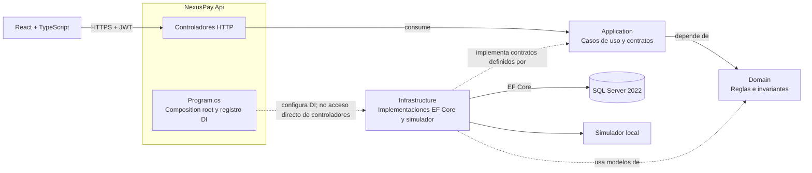
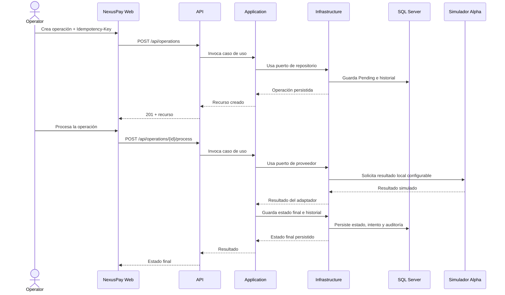

# NexusPay

## Financial Operations & API Integration Platform

NexusPay es una aplicación web de demostración empresarial para administrar clientes ficticios, operaciones financieras simuladas, proveedores locales, auditoría y reportes. **No procesa dinero real, no usa tarjetas ni se conecta a bancos.**

## Estado del proyecto

El backend está implementado con autenticación y autorización por roles, gestión de clientes/usuarios/proveedores, pagos simulados, dashboard, auditoría y reportes paginados/CSV. El frontend incluye login, navegación por rol y pantallas conectadas a la API. La base local usa SQL Server 2022 en un contenedor dedicado; `MSSQLSERVER04` con SQL Server 2016 permanece separada e intacta.

Verificación local registrada el 2026-11-06:

- Backend: 21 pruebas unitarias y 7 de integración aprobadas contra SQL Server 2022.
- Frontend: lint y build aprobados en la actualización de UX actual; las 3 pruebas Vitest aprobaron en la verificación anterior y no se volvieron a ejecutar en esta actualización.
- El cliente web ahora explica una sesión expirada o una API inaccesible; ya no presenta un aviso vacío ante respuestas HTTP sin detalle.
- EF Core: cuatro migraciones aplicadas; sin cambios de modelo pendientes.
- CI: workflow definido para crear una instancia efímera de SQL Server 2022 y publicar TRX. No se ejecutó en GitHub desde esta sesión.

## Funcionalidades

- Autenticación JWT, cambio de contraseña, roles `Administrator`, `Operator` y `Auditor`.
- CRUD lógico de clientes, búsqueda, filtros, paginación y desactivación.
- Ficha de cliente con datos de contacto y documento; formulario con tipos de documento predefinidos.
- Creación idempotente de operaciones, historial, cancelación y procesamiento simulado con éxito, rechazo, error o timeout configurables.
- Administración de cuentas y roles; acciones administrativas auditadas y transaccionales.
- Consulta y administración de metadatos de proveedores simulados.
- Dashboard con datos persistidos, auditoría, logs de integración e informes por operación, cliente y proveedor, en JSON y CSV con límite de 10.000 filas.
- Interfaz responsive con login, dashboard, clientes, operaciones, proveedores, auditoría, reportes y usuarios.
- Navegación por teclado con foco visible, salto al contenido y errores de sesión/conexión con mensajes en español.

El procesamiento actual usa el simulador configurado en `PaymentSimulation`; registrar un proveedor agrega sus metadatos y estado, pero no instala una integración ejecutable nueva. No hay proveedores bancarios ni llamadas externas.

## Tecnologías

- **Backend:** C#, .NET 10, ASP.NET Core Web API, EF Core 10, FluentValidation, ASP.NET Core Identity, JWT, Serilog y Swagger.
- **Frontend:** React, TypeScript, Vite, Tailwind CSS, React Router, React Hook Form, Zod y Recharts.
- **Pruebas:** xUnit, `Microsoft.AspNetCore.Mvc.Testing`, Vitest, React Testing Library y jsdom.
- **Datos/CI:** SQL Server 2022 Developer, Docker Desktop, GitHub Actions.

## Arquitectura y flujo

La solución usa Clean Architecture pragmática, sin MediatR ni AutoMapper:



Las dependencias de código apuntan hacia Domain. La referencia API → Infrastructure se usa en `Program.cs` para registrar servicios en Dependency Injection; los controladores consumen casos de uso de Application. Infrastructure implementa los contratos que Application define.



La solución contiene `src/NexusPay.Api`, `Application`, `Domain` e `Infrastructure`; pruebas en `tests/`; frontend en `frontend/nexuspay-web`; documentación y ADRs en `docs/`. Ver [arquitectura](docs/architecture/architecture.md), [diseño de datos](docs/database/database-design.md), [ERD](docs/database/erd.md) y [guía API](docs/api/api-guide.md).

## Requisitos

- .NET SDK 10.0.300 o posterior de la banda 10.0.
- Node.js 24 y npm.
- Docker Desktop con motor Linux/WSL 2, o SQL Server 2022 compatible ya instalado.
- Git. Visual Studio o VS Code son opcionales.

La imagen `mcr.microsoft.com/mssql/server:2022-latest` ocupa aproximadamente **2,35 GB** en Docker en este equipo; la primera descarga consume red y espacio adicional. SQL Server usa memoria y CPU mientras el contenedor está activo. No hay cargo cloud; se aplican los términos de SQL Server Developer (desarrollo/pruebas).

## Configuración local

### 1. Iniciar SQL Server

En el equipo de desarrollo ya existe el contenedor `nexuspay-sql2022` con el volumen dedicado `nexuspay-sql2022-data`:

```powershell
docker start nexuspay-sql2022
```

Al preparar otra máquina, utiliza una imagen SQL Server 2022 en un contenedor/volumen nuevos y un puerto libre. No reutilices ni elimines volúmenes que ya contengan datos. En esta configuración SQL se publica únicamente en `127.0.0.1:1433`; no comparte instancia con SQL Server 2016.

La base `NexusPay` y el login de desarrollo `nexuspay_app` ya están creados en el entorno de este workspace. Para un entorno nuevo, crea la base y un usuario de aplicación con permisos de esquema de desarrollo mediante SQL Server Management Studio o el procedimiento DBA de tu equipo.

### 2. Configurar secretos locales

La API usa .NET User Secrets; no pongas cadenas privadas en `appsettings.json`, variables `VITE_*`, commits o capturas. Desde la raíz:

```powershell
dotnet user-secrets set "ConnectionStrings:NexusPay" "Server=localhost,1433;Database=NexusPay;User Id=nexuspay_app;Password=<contraseña-local>;Encrypt=False;TrustServerCertificate=True" --project src/NexusPay.Api
dotnet user-secrets set "BootstrapAdmin:Email" "admin@nexuspay.local" --project src/NexusPay.Api
dotnet user-secrets set "BootstrapAdmin:Password" "<contraseña-local-fuerte>" --project src/NexusPay.Api
```

Genera una clave JWT aleatoria Base64 de al menos 32 bytes y guárdala como `Jwt:SigningKey` en User Secrets. Ejemplo PowerShell que no imprime la clave:

```powershell
$bytes = New-Object byte[] 48
[Security.Cryptography.RandomNumberGenerator]::Fill($bytes)
$jwtKey = [Convert]::ToBase64String($bytes)
dotnet user-secrets set "Jwt:SigningKey" $jwtKey --project src/NexusPay.Api
Remove-Variable jwtKey, bytes
```

En el arranque de desarrollo se crean los roles y la cuenta admin configurada si aún no existe. No se versionan esas credenciales. El frontend solo necesita la URL pública de la API; copia `.env.example` a `.env.local` si deseas cambiarla.

### 3. Restaurar, migrar y ejecutar

```powershell
dotnet restore NexusPay.sln
dotnet ef database update --project src/NexusPay.Infrastructure --startup-project src/NexusPay.Api
dotnet run --project src/NexusPay.Api --launch-profile http
```

API: `http://localhost:5062`; Swagger (solo Development): `http://localhost:5062/swagger`; salud API/SQL: `http://localhost:5062/health`.

En otra terminal:

```powershell
cd frontend/nexuspay-web
npm ci
npm run dev
```

Frontend: `http://localhost:5173`. Inicia sesión con el correo y contraseña que configuraste en User Secrets.

## Base de datos e IgnoreCase

La base usa `Latin1_General_100_CI_AS` (no distingue mayúsculas/minúsculas y sí acentos). Los correos/códigos se normalizan y tienen índices únicos. Tablas operacionales: `Customers`, `FinancialOperations`, `OperationStatusHistory`, `PaymentProviders`, `PaymentAttempts`, `IntegrationLogs`, `AuditLogs`; Identity agrega `AspNetUsers`, roles, relaciones, claims, logins y tokens. Importes usan `decimal(18,2)`, operaciones tienen `rowversion` y claves foráneas restrictivas. Ver [diseño](docs/database/database-design.md) y [ERD](docs/database/erd.md).

## API y roles

Los cambios requieren JWT `Bearer`, excepto login y health. `Administrator` administra usuarios y proveedores; `Administrator`/`Operator` escriben clientes/operaciones; `Auditor` consulta operaciones, logs, auditoría y reportes. El backend exige roles aunque la UI oculte acciones. Cuando un JWT expira, la UI informa que la solicitud no se guardó y solicita iniciar sesión otra vez.

Principales rutas: `POST /api/auth/login`, `GET /api/auth/me`, `POST /api/auth/change-password`; `/api/users`; `/api/customers`; `/api/operations`; `GET/POST /api/providers`, `PUT /api/providers/{id}`; `/api/audit-logs`; `/api/integration-logs`; `/api/dashboard/summary`; `/api/reports/operations`, `/customers` y `/providers`, cada reporte con descarga `.csv`; `GET /health`. La [guía API](docs/api/api-guide.md) detalla filtros, payloads, paginación, errores y acceso.

Ejemplo de operación (requiere cliente activo):

```http
POST /api/operations
Authorization: Bearer <token>
Idempotency-Key: <clave-unica-de-la-solicitud>
Content-Type: application/json

{"customerId":"<guid>","type":"Payment","amount":25.50,"currency":"PEN","description":"Pago ficticio"}
```

Las repeticiones con la misma clave y carga devuelven el recurso existente; una clave reutilizada con otra carga produce conflicto.

## Pruebas

Backend (las integraciones requieren SQL Server 2022 y base aislada):

```powershell
dotnet test NexusPay.sln -c Release
```

Configura `ConnectionStrings:NexusPayIntegrationTests`, `NEXUSPAY_TEST_ADMIN_EMAIL` y `NEXUSPAY_TEST_ADMIN_PASSWORD` en User Secrets/entorno para `NexusPay.IntegrationTests`. La fixture aplica migraciones solo a `NexusPay_IntegrationTests`; no apunta a `NexusPay` ni a `MSSQLSERVER04`.

Frontend:

```powershell
cd frontend/nexuspay-web
npm ci
npm run lint
npm test
npm run build
```

## Seguridad y límites conocidos

Passwords se gestionan con Identity; JWT vive 15 minutos y el cliente lo conserva en `sessionStorage`, que reduce persistencia entre sesiones pero sigue siendo accesible a scripts ejecutados en el origen. Secretos backend van en User Secrets y los tests CI generan credenciales efímeras en el runner. Logs/auditoría redactan datos sensibles. Los datos deben ser ficticios. El simulador no procesa pagos; cambiar `PaymentSimulation:Outcome` permite probar `Approved`, `Rejected`, `TechnicalError` o `Timeout`. No se ha hecho auditoría externa ni despliegue de producción.

Detalles y límites en [seguridad](docs/security/security.md), [preparación para producción](docs/deployment/production-readiness.md), [pruebas](docs/testing/testing-guide.md) y [ADR-002](docs/decisions/ADR-002-sql-server-target.md).

## CI/CD

`.github/workflows/ci.yml` restaura/compila .NET, inicia SQL Server 2022 efímero con credenciales generadas en ejecución, ejecuta xUnit y publica archivos TRX; el job frontend ejecuta `npm ci`, lint, Vitest y build. No publica a Azure ni a GitHub Packages.

## Capturas

No hay capturas reales incluidas todavía. Las instrucciones para capturas futuras están en [`docs/screenshots/README.md`](docs/screenshots/README.md); no se incluyen imágenes de ejemplo como si fueran del producto.

## Roadmap y limitaciones

- [x] Diagnóstico, arquitectura, SQL Server 2022 aislado y migraciones EF Core 10.
- [x] Dominio, aplicación, persistencia y simulador configurable.
- [x] API, identidad, roles, auditoría, dashboard y reportes JSON/CSV.
- [x] Interfaz responsive conectada a los módulos backend.
- [x] Pruebas unitarias, integración SQL y pruebas frontend locales.
- [x] Workflow de CI definido.
- [ ] Ejecutar/verificar el workflow en GitHub cuando el repositorio tenga remoto.
- [ ] Recuperación de contraseña con canal de verificación.
- [ ] Proveedores con adaptadores ejecutables seleccionables en tiempo de ejecución.
- [ ] Capturas visuales reales y despliegue opcional, solo con autorización.

La interfaz fue compilada y probada con Vitest, pero no se pudo hacer inspección visual en navegador desde esta sesión. No existe un despliegue remoto configurado.

## Contribuir y licencia

Consulta [CONTRIBUTING.md](CONTRIBUTING.md). Licencia MIT: [LICENSE](LICENSE). English README: [README.en.md](README.en.md).
