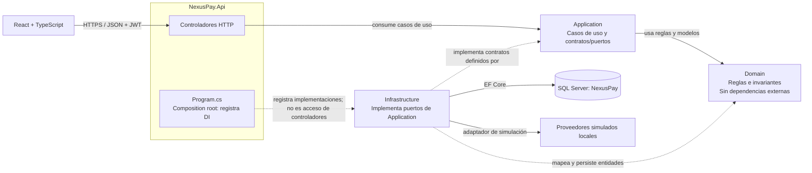
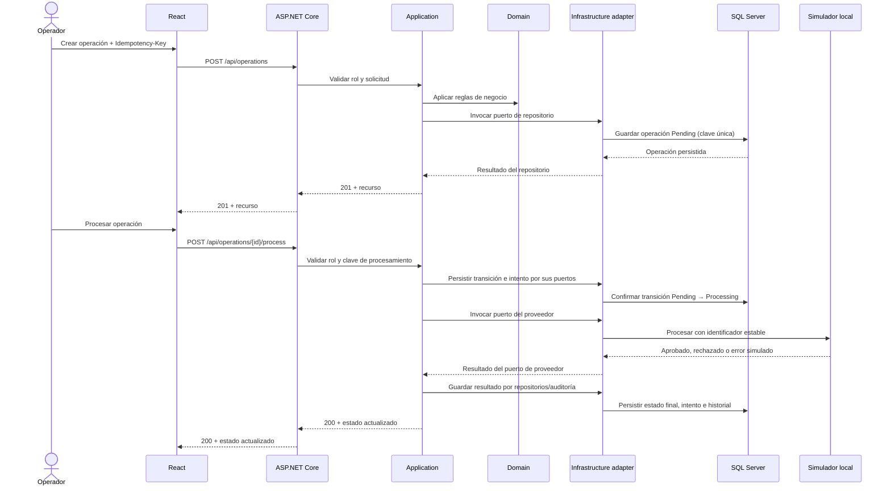

# Arquitectura de NexusPay

## Estado

Diseño de Fase 1 actualizado con el avance de Fases 2–7. Domain/Application contienen reglas, validaciones, contratos y casos de uso; Infrastructure contiene EF Core, repositorios y simulador determinista. La API implementa identidad/JWT/roles, clientes, operaciones, pagos simulados, administración y consulta de metadatos de proveedores, auditoría, logs, dashboard y reportes de operaciones/clientes/proveedores con CSV. El frontend tiene login y páginas conectadas por rol, ficha del cliente y mensajes accionables para sesión/API. En la actualización de UX actual pasaron lint y build; la suite automatizada se ejecutó antes de estos últimos cambios. GitHub Actions está definido pero no ejecutado en un remoto.

## Objetivo y límites

NexusPay centraliza clientes ficticios, operaciones financieras simuladas y la observabilidad de proveedores locales. No mueve dinero, no procesa tarjetas y no llama a bancos. Las decisiones favorecen una aplicación modular que una persona pueda ejecutar y explicar.

## Arquitectura implementada

NexusPay usa Clean Architecture pragmática con cuatro proyectos de producción y dos proyectos de pruebas. Las dependencias de código apuntan hacia dentro, al dominio:

| Proyecto | Responsabilidad | Puede depender de |
| --- | --- | --- |
| `NexusPay.Domain` | Entidades, enumeraciones, reglas invariantes y excepciones de dominio | BCL de .NET |
| `NexusPay.Application` | Casos de uso, DTOs, validaciones, políticas e interfaces de persistencia/integración | Domain |
| `NexusPay.Infrastructure` | EF Core, SQL Server, Identity, simuladores, logging y adaptadores técnicos | Application, Domain |
| `NexusPay.Api` | HTTP, autenticación/autorización, configuración, middleware, Swagger y composición de dependencias | Application, Infrastructure |

La API consume Application mediante controladores y casos de uso; los controladores no acceden directamente a Infrastructure. Application define puertos y contratos de persistencia/integración, y Infrastructure los implementa con EF Core y adaptadores técnicos. `NexusPay.Api/Program.cs` es el composition root: allí se registran esas implementaciones en Dependency Injection. La referencia de compilación API → Infrastructure existe para esa composición, no para que los controladores la usen. Domain no referencia Application, Infrastructure ni API. No se añade MediatR ni AutoMapper: la coordinación explícita y el mapeo manual son suficientes para este tamaño.

El frontend es una aplicación React/TypeScript independiente que consume la API REST mediante un cliente HTTP centralizado y mantiene estado local por pantalla.



La flecha punteada `Program.cs → Infrastructure` representa composición de dependencias únicamente. En ejecución, Application invoca sus abstracciones y el contenedor resuelve los adaptadores registrados. Domain no conoce ni depende de las capas externas.

## Módulos y límites

- **Identidad:** ASP.NET Core Identity, JWT de corta duración y roles `Administrator`, `Operator`, `Auditor`. La API comprueba permisos; ocultar acciones en React solo mejora la experiencia.
- **Clientes:** alta, consulta, actualización, búsqueda paginada y desactivación lógica. Los clientes con operaciones no se eliminan físicamente.
- **Operaciones:** creación idempotente, consulta y transiciones válidas de estado. `rowversion` resuelve escrituras concurrentes.
- **Pagos simulados:** selección de proveedor habilitado y resultado configurable localmente. El simulador no recibe PAN, cuentas ni credenciales reales.
- **Proveedores e integración:** contrato común de proveedor, registro de intentos, correlation ID y errores técnicos redactados. Solo se incorpora un mecanismo de reintento si los casos de error simulados lo requieren; los reintentos quedan limitados y no duplican solicitudes.
- **Auditoría:** cambios operacionales con actor, acción, entidad, fecha, correlation ID y resultado. No guarda contraseñas, JWT ni secretos.
- **Dashboard y reportes:** agregaciones consultadas de datos persistidos, filtros acotados por fecha y exportación CSV con límite de filas.

## Flujo de creación y procesamiento



La llamada al simulador no se mantendrá dentro de una transacción SQL abierta. La transición a `Processing` se confirma primero y se registra un intento; el resultado y el estado final se confirman después. El simulador recibirá una clave estable para reconocer repeticiones. En esta versión síncrona un fallo inesperado puede dejar una operación en `Processing`; se documentará un procedimiento de recuperación local y se evaluará un worker solo si las pruebas muestran que hace falta.

## Estados y reglas de dominio

`Pending → Processing → Completed | Failed`. `Pending → Cancelled` se permite a un operador autorizado. `Failed → Processing` se permite únicamente como reintento explícito dentro del máximo configurado, con una nueva clave de procesamiento. No hay transición desde `Completed` o `Cancelled`. Los errores de timeout son resultados del simulador, no una afirmación sobre una red bancaria.

El monto se almacena como `decimal(18,2)` y debe ser positivo. Se aceptan solo monedas incluidas en una lista explícita inicial (`PEN`, `USD`, `EUR`). El catálogo queda configurado en el backend, no controlado por el cliente HTTP.

## Seguridad y configuración

- Contraseñas mediante Identity; nunca se almacenan en texto plano.
- JWT validado con emisor, audiencia, firma y expiración configurados en User Secrets localmente. No se incluirán secretos en el repositorio.
- La cuenta inicial de administración se creará mediante un procedimiento local de bootstrap alimentado por User Secrets; no habrá credenciales de demostración incrustadas.
- CORS permitirá solo el origen local configurado durante desarrollo. En despliegue se deberá definir una lista explícita.
- Errores HTTP en `ProblemDetails`, con código de aplicación y correlation ID; sin stack trace en respuestas de producción.
- Serilog con datos estructurados y política de redacción; la información personal ficticia no se copiará a logs de integración.
- Rate limiting en endpoints de autenticación y límites razonables de paginación/exportación.

## Estructura objetivo

```text
NexusPay/
├── src/
│   ├── NexusPay.Api/                 # Controllers, middleware, composición
│   ├── NexusPay.Application/          # Casos de uso, contratos, DTOs
│   ├── NexusPay.Domain/               # Entidades y reglas
│   └── NexusPay.Infrastructure/       # EF Core, Identity, simuladores
├── tests/
│   ├── NexusPay.UnitTests/
│   └── NexusPay.IntegrationTests/
├── frontend/nexuspay-web/             # React + TypeScript + Vite
├── docs/
│   ├── architecture/
│   ├── database/
│   ├── api/
│   ├── security/
│   ├── testing/
│   ├── decisions/
│   └── screenshots/
├── scripts/
└── .github/workflows/
```

La estructura anterior existe en el repositorio. Las limitaciones y mejoras pendientes se enumeran en el README y en la guía de seguridad.

## Decisiones principales

1. SQL Server es el motor de referencia y EF Core administra el esquema con migraciones.
2. Identity evita diseñar hashing, tokens de contraseña y persistencia de roles propios.
3. Las simulaciones locales reemplazan proveedores de dinero real.
4. La idempotencia se respalda con índices únicos en la base de datos y verificación del hash de solicitud; una comprobación solo en memoria no es suficiente.
5. Auditoría y cambios de estado se guardan junto con las operaciones que describen cuando forman parte de la misma transacción.
6. No habrá despliegue ni publicación automática a GitHub/Azure sin autorización expresa.

