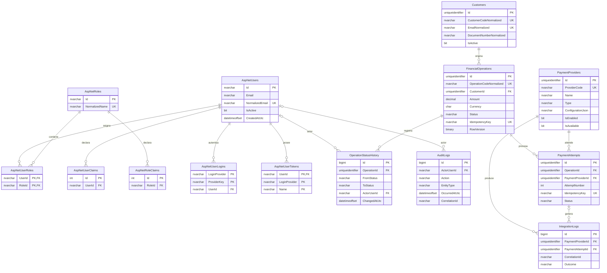

# Diagrama ERD

ERD basado en las entidades y configuraciones EF Core actuales. ASP.NET Core Identity aporta las siete tablas estándar; `ActorUserId` en historial y auditoría referencia `AspNetUsers`, mientras que no se almacenan relaciones de usuario creador en clientes u operaciones.

