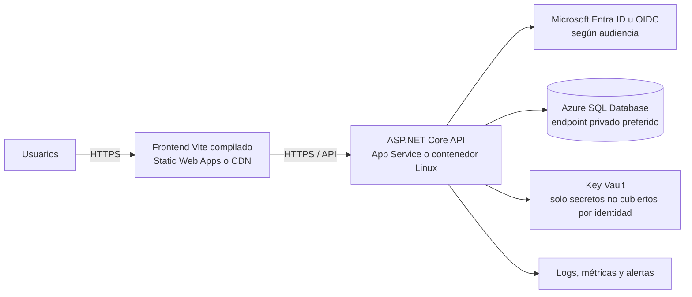

# Preparación para producción

## Estado actual

NexusPay está preparado para desarrollo y demostración local, pero **no está listo para administrar operaciones financieras reales ni para ponerse frente a usuarios externos**. El flujo de pagos es un simulador; los proveedores registrados son metadatos y no conectores ejecutables. El frontend conserva el JWT en `sessionStorage`; la UI informa de un `401` y de que la solicitud no se guardó, pero el diseño de sesión necesita endurecimiento antes de un lanzamiento.

La base local está en SQL Server 2022 Developer sobre Docker. Esta edición es solo para desarrollo, pruebas y demostración; no debe alojar producción ni recibir una copia de la base local de prueba. Elija Azure SQL, SQL Server Standard/Enterprise con licencia adecuada u otro destino aprobado. [Ediciones de SQL Server 2022](https://learn.microsoft.com/en-us/sql/sql-server/editions-and-components-of-sql-server-2022/)

## Topología sugerida en Azure

La siguiente propuesta es una opción, no una infraestructura ya creada:

Una identidad administrada de App Service puede acceder a Azure SQL sin usuario ni contraseña; para otros secretos se puede conceder acceso al Key Vault mediante esa identidad. [Conexión sin secretos con identidad administrada](https://learn.microsoft.com/en-us/azure/app-service/tutorial-connect-msi-sql-database), [conexión segura a recursos Azure](https://learn.microsoft.com/en-us/azure/app-service/tutorial-connect-overview).

## Lista de preparación

### Producto y datos

- Decidir si NexusPay seguirá como consola de operaciones simuladas o si el alcance incluye dinero real. Para pagos reales hay que diseñar e integrar un proveedor con certificación/contrato, revisar obligaciones regulatorias y determinar el alcance PCI con especialistas; el simulador actual no cumple ese papel.
- Definir clasificación de datos, base legal, retención, solicitudes de acceso/borrado, residencia y anonimización. Usar un conjunto limpio de producción; no promover filas de desarrollo, pruebas o demostración.
- Definir usuarios esperados, concurrencia, volumen, objetivos de disponibilidad, RPO/RTO, región y presupuesto. Sin esos datos no es responsable elegir tamaño o costo de servicio.

### Identidad y aplicación

- Reemplazar `sessionStorage` para el JWT por un patrón de sesión apropiado, preferentemente BFF/cookie `HttpOnly`, `Secure`, `SameSite` o OIDC con un proveedor mantenido. Añadir protección CSRF cuando se usen cookies. OWASP desaconseja guardar JWT y otros identificadores de sesión en Web Storage porque el JavaScript del origen puede leerlos. [Guía OWASP de gestión de sesión](https://cheatsheetseries.owasp.org/cheatsheets/Session_Management_Cheat_Sheet)
- Añadir MFA o federación OIDC para usuarios administrativos, recuperación de contraseña con canal verificado, rotación/revocación de sesiones y política de bloqueo revisada.
- Mantener JWT, claves, credenciales y secretos fuera de Git, `appsettings`, variables `VITE_*`, logs e imágenes Docker. En Azure, usar identidad administrada; almacenar en Key Vault solo lo que requiera secreto. User Secrets es para desarrollo, no es almacén de producción. [Configuración y secretos de ASP.NET Core](https://learn.microsoft.com/en-us/aspnet/core/fundamentals/configuration/).
- Mantener `Administrator`, `Operator` y `Auditor` con privilegio mínimo, revisar alta/baja de usuarios y registrar accesos/cambios sensibles.
- Configurar CORS para el dominio HTTPS definitivo, encabezados de seguridad, protección contra CSRF/XSS según el modelo de sesión y límites de abuso distribuidos si hay varias réplicas.

### Red y base de datos

- Mantener SQL sin acceso público cuando el hosting lo permita; autorizar solo la red/origen de la API y administrar con una vía separada.
- Usar TLS con certificado validado y `TrustServerCertificate=False`; la conexión local del contenedor confía en su certificado y no se debe copiar a producción. [Cifrado y validación de certificados de SqlClient](https://learn.microsoft.com/en-us/sql/connect/ado-net/connection-string-syntax?view=sql-server-ver17)
- Usar identidad administrada hacia Azure SQL o credenciales dedicadas de mínimo privilegio si la plataforma no soporta identidad administrada. Separar principal de despliegue/migraciones del principal runtime.
- Mantener backups automáticos, retención definida y restauraciones periódicas ensayadas. Determinar si se requiere redundancia zonal o regional según RPO/RTO.
- Aplicar migraciones como paso de release revisado y auditable, antes de desplegar las réplicas; no ejecutar `Migrate()` automáticamente en cada instancia de producción.
- Definir archivado/retención de `AuditLogs` e `IntegrationLogs`, límites de exportación y política de crecimiento.

### Entrega, operación y soporte

- Ampliar GitHub Actions: restore, build, lint, pruebas, análisis de dependencias y publicación de artefactos; luego despliegue a staging, smoke tests y promoción con aprobación. El workflow actual solo hace CI y no se ha ejecutado en GitHub.
- Separar desarrollo, staging y producción: recursos, identidades, claves, orígenes CORS, usuarios y bases distintas. Nunca copiar los secretos de un entorno a otro.
- Configurar logs estructurados sin datos personales/credenciales, métricas, trazas, alertas, correlation IDs y un tablero de disponibilidad. Probar límites de rate limit con varias réplicas.
- Añadir pruebas de aceptación en navegador, accesibilidad, carga, concurrencia, fallos de SQL/proveedor, expiración de sesión, autorización por rol, recuperación y restauración de backup.
- Completar revisión de seguridad y privacidad; definir respuesta a incidentes, contactos de guardia, rollback de artefactos y procedimientos de rotación de claves.

## Soporte de plataforma

.NET 10 es LTS y Microsoft indica soporte hasta el 14 de noviembre de 2028; EF Core 10 es LTS. Hay que mantener runtime y paquetes en sus actualizaciones de seguridad vigentes. [Política de soporte de .NET](https://dotnet.microsoft.com/en-us/platform/support/policy/dotnet-core), [EF Core 10](https://learn.microsoft.com/en-us/ef/core/what-is-new/ef-core-10.0/whatsnew). SQL Server 2022 tiene soporte extendido hasta el 12 de enero de 2033; esa fecha de ciclo de vida no convierte Developer Edition en apta para producción. [Ciclo de vida de SQL Server 2022](https://learn.microsoft.com/en-us/lifecycle/products/sql-server-2022)
